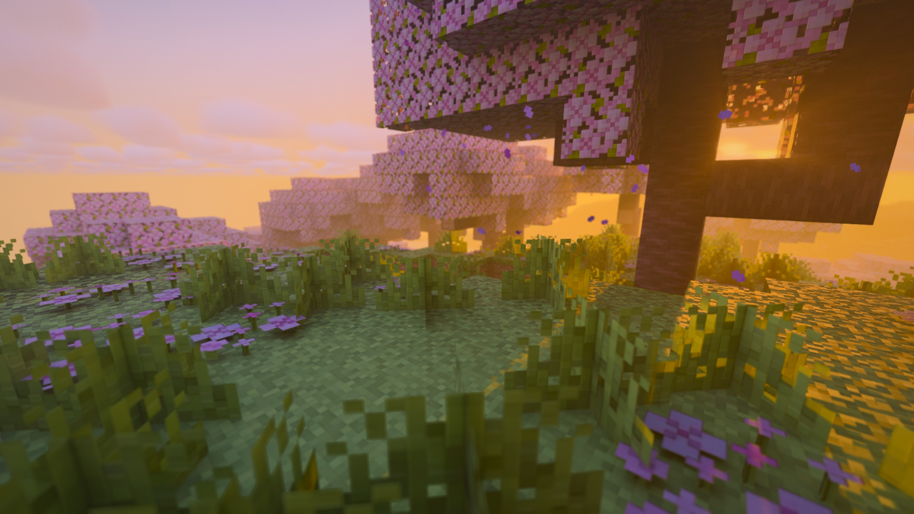
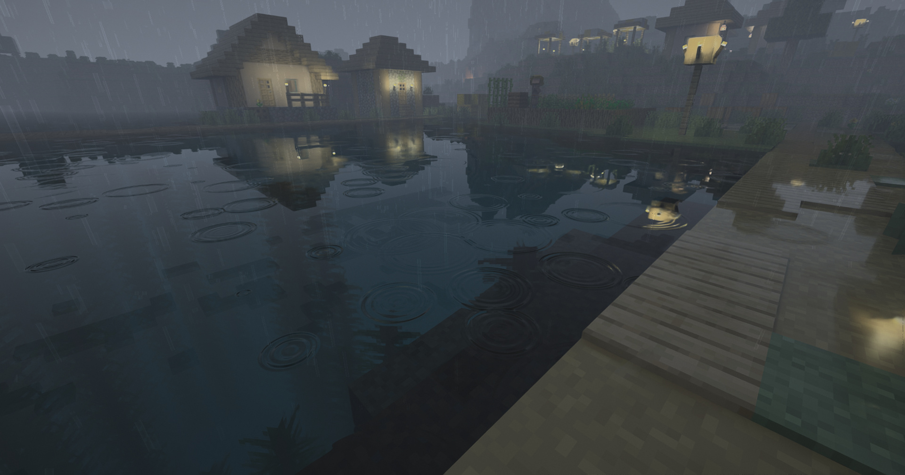
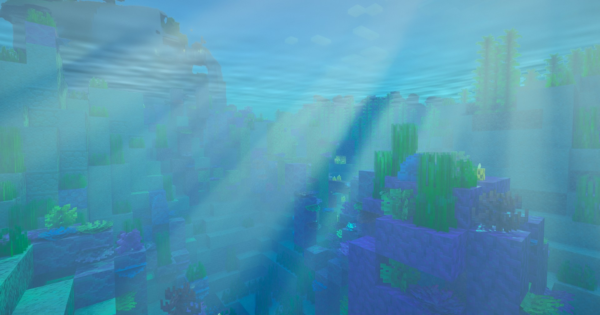
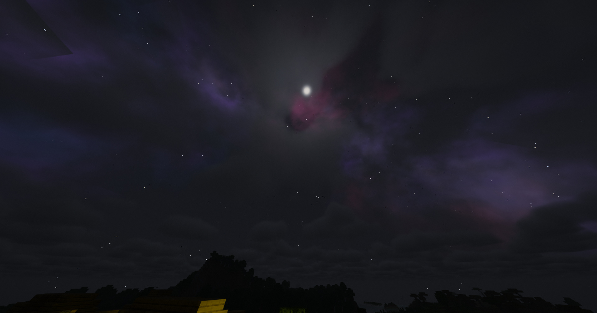

# Chromance-VKPT

[English](README.md) · **繁體中文** · [简体中文](README.zh-CN.md)

為 [Radiance](https://github.com/Minecraft-Radiance) 模組從零撰寫的路徑追蹤光影包。畫面追求溫暖、帶風格的氛圍，
但光照完全由真實的路徑追蹤計算。

## 名稱由來

**Chromance** = **Chroma** + **Radiance**。*Chroma* 是「色彩」：每支火把、每盞燈籠都帶著自己的顏色照亮世界，
天空隨時段變換色調，暖色陽光對上偏藍的陰影。*Radiance* 既是這個光影包所服務的模組，也是路徑追蹤實際在計算的物理量，
也就是沿著每一條光線傳遞的光。**VKPT** 代表 **Vulkan Path Tracing**（Vulkan 路徑追蹤），也就是它背後的技術。

> 目前狀態：**持續調整中**。四個開發階段（核心、水與雨、雲、曝光與拍照）都已完成，接下來以修正與調整畫面為主。

## 畫面

| 雨天的村莊 | 水下 |
| --- | --- |
|  |  |

## 功能

- **路徑追蹤光照**：日月光與柔和陰影、天空光、多次反彈的間接光。日月是主要光源，陰影清楚。
- **彩色方塊光源**：火把、燈籠、螢石、岩漿等所有發光表面都以自己的顏色照亮周圍。光源是直接取樣而不是靠隨機碰到，
  所以**移動時不會閃爍**。
- **有限的照明範圍**：方塊光在可調距離內衰減到零，火把只照亮一小塊，外面維持黑暗，就像在黑暗中點亮打火機。
- **微弱發光只當裝飾**：發光地衣、材質包的發光礦石等微弱光源畫面上仍會發光，但預設不再照亮洞穴
  （可用「弱發光照明」打開）。岩漿等強光源也調暗，不再讓畫面過曝。
- **洞穴**：在地底完全不計算太陽；有部分開口（豎井、洞口）時，依看得到多少天空按比例計算。洞穴霧氣更暗更淡，
  地底的水也不再發光。
- **時段調色**：晴天深藍的天空配上暖白的地平線、日出日落金黃、太陽剛下山／剛升起的藍調時刻、昏暗的月夜。
- **陽光光束**：日光與月光穿過樹葉、建築與雲縫形成的光束（丁達爾效應），另有畫面空間的光束讓地面上也看得到光柱。
  被山擋住的夕陽會是暗的剪影，光從邊緣透出。
- **日月形狀**：圓形或原版的方形，圓形月亮會顯示月相。
- **labPBR 1.3**：光滑度、F0 與預設金屬、自發光、次表面散射（葉子透光）、法線貼圖、環境光遮蔽。
- **玻璃**：清澈透明、染色玻璃帶顏色；後方比較暗時（像夜晚的窗戶）玻璃會像鏡子一樣反射。玻璃與金屬的倒影
  不會被降噪器抹糊；「金屬反射銳利度」可讓金屬方塊的反射比材質包設定的更清楚。
- **水**：從上方看清澈透明的水，有反射與折射；緩慢移動的波紋（在降噪後才疊上，不會凍住或拖影）；水底零星的細線焦散。
  水下的顏色依真實順序隨深度消失（紅色最先，接著黃、綠，藍色最後），水下光束隨深度變淡，霧氣隨照得到的日光變化。
  往上看有斯涅耳窗：頭頂一個圓形窗口看得到水面以上，周圍的水面映出水下（也可選乾淨的全反射或全穿透）。
  特殊生物群系的水（暖水海洋、沼澤等）保留自己的顏色。
- **下雨**：濕潤反光的地面、水薄膜與積水；漣漪是幾圈細細的波紋，大小不一、隨機交疊，積水與開放水面都有；
  雨絲透明會折射。下雨時太陽被雨雲遮住，不會有陽光陰影。
  只有真的會下雨、而且淋得到雨的地方會變濕（沙漠與雪地保持乾燥），雨停後地面慢慢變乾。
- **雲**：體積雲（晴天蓬鬆分散，下雨時合成灰色的整片雲層）與移動的雲影，或同樣會投下陰影的原版方塊雲。
- **夜空**：星星會被雲擋住，另有可選的淡淡彩色星雲帶。
- **眼睛適應**：走到陽光下先刺眼再快速恢復，進入黑暗要幾秒才適應，洞穴依然是暗的。
- **掉落物與實體光源**：掉在地上的光源方塊（螢石、火把、燈籠……）會照亮周圍。
- **發光的生物眼睛**：終界使者、蜘蛛、夜魅等生物的眼睛會發光，使用 Radiance 自帶的眼睛發光貼圖，
  不需要材質包，也不會把生物的身體照亮。
- **夜視**：夜視效果會柔和地提亮畫面（水下也有效），而不是一片死白。
- **旁觀者模式**：在實心方塊裡時，周圍的牆面以均勻的光照直接畫出，穿牆飛行保持流暢，也不會出現看到天空的破洞。
- **泛光與景深**：亮處柔和地發光；可選的景深，支援自動對焦（對準準星）或固定距離。
- **調色**：冷暖分離、電影感的畫面張力、對比度、飽和度、暗角、膠片顆粒，以及去除 8 位元色帶的處理。
- 支援 Radiance 的降噪器（DLSS 光線重建或 NRD）與畫面放大器，建議使用 DLSS 光線重建。
- **光不會亂漏**：光源只從正面發光；材質包標成次表面散射的實心方塊也不再讓光穿透，地板與天花板不會漏光。
  發光漿果等原版本來就會發光的方塊，即使關閉弱發光照明也會照亮周圍。
- **線性材質顏色**：貼圖保留原本的對比與顏色，不會灰灰霧霧的。
- **遠距離座標**：在離原點上百萬格的地方，水波、漣漪、積水、雨、焦散與雲也不會因浮點精度不足而變成一格一格的馬賽克。

## 需求

- Minecraft **1.21.4** 與 **Radiance 0.1.6-alpha**（Fabric）。
- 支援硬體光追的顯示卡（NVIDIA RTX 等），開發環境為 RTX 3080。
- 需保持 Radiance 的「區塊發光收集」開啟（預設開啟），方塊光源依賴它；關閉時 Radiance 會改用內建光影包。

## 安裝

1. 將光影包（資料夾或 zip）放入 `<遊戲實例>/shaderpacks/`。
2. 在遊戲中打開 Radiance 設定的光影包頁面，選擇 **Chromance VKPT**。
3. **更新光影包後，請在光影包設定頁按「全部重設」**。Radiance 會在第一次載入時記住所有設定值，
   新的預設值要重設後才會生效。
4. **建議的 Radiance 色調映射設定**：開啟「手動曝光」、「手動曝光 EV」設為 **0**、「曲線提亮上限」設為 **0**。
   Chromance 的亮度是按最終畫面設計的，並由光影包自己的眼睛適應調整曝光；Radiance 的自動曝光與暗部提亮
   會把夜晚和雨天拉回接近白天的亮度。
5. Minecraft 本身的「亮度」（伽瑪）請維持預設，要調亮暗請用光影包的「整體亮度」設定。

## 設定總覽

| 分類 | 內容 |
| --- | --- |
| 光照 | 整體亮度、間接光反彈次數、陽光／月光／天空光強度、環境天空光、陽光光束、陰影柔和度、最低亮度 |
| 方塊光源 | 強度、照明範圍、每個表面的光線數與候選數、取樣亮度上限、掉落物與實體光源、弱發光照明 |
| 天空與時段 | 日月形狀與大小、黃金時刻、藍調時刻、夜晚亮度與色調、夜空星雲 |
| 霧與水體 | 霧氣、邊界霧起點、水下看水面（斯涅耳窗）、水的混濁度、生物群系水色、水面波紋、水下光束、雲、雲量、雲的品質、雲影 |
| 雨天 | 地面濕潤、積水、漣漪、雨絲數量與不透明度 |
| 材質 | labPBR 貼圖過濾、法線貼圖強度、玻璃反射、金屬反射銳利度、線性材質顏色 |
| 相機 | 眼睛適應、適應程度、暗處適應上限、適應速度、景深（自動對焦、對焦距離、強度） |
| 調色 | 泛光（強度、門檻）、對比度、飽和度、自然飽和度、冷暖分離、畫面張力、暗角、膠片顆粒 |

效能提示：「間接光反彈次數」、「方塊光源光線數」、「雲的品質」與「陽光光束」影響最大。

## 開發進度

1. ~~核心：路徑追蹤、labPBR、彩色光源、防閃爍、時段調色、日月形狀、夜晚~~
2. ~~水與雨：波紋、焦散、水下氛圍、生物群系水色、濕地面與漣漪、透明雨絲~~
3. ~~雲：體積雲與方塊雲，以及雲影~~
4. ~~曝光與拍照：眼睛適應、掉落物光源、泛光、景深~~

## 已知限制

- 材質包的微弱發光貼圖（例如發光礦石）即使關閉「弱發光照明」，仍在 Radiance 的光源清單內，
  畫面內數量很多時（例如用透視看整個洞穴系統）會吃掉一些幀數。
- 不使用 DLSS 光線重建（改用 NRD）時，小光源與洞穴的雜訊較多，建議使用 DLSS 光線重建。

- 離原點非常遠時（約一百萬格以上），方塊與光源本身的位置仍受 Minecraft 與 Radiance 的浮點精度限制，這部分光影包無法修正。
  光影包自己的水波、雲等圖案每 16384 格重複一次，跨過那條線時圖案會跳一下。

## 致謝

- [Radiance / MCVR](https://github.com/Minecraft-Radiance)：渲染器與光影包介面。
- Radiance 內建的 **Vanilla PT** 光影包：介面層（幾何與材質解碼、透明測試、粒子／文字／星星的光柵化步驟）的參考，
  `interface/` 與 `post/` 內的檔案衍生自它；`textures/` 內的體積雲雜訊貼圖（`cloud_shape_noise.raw`、
  `cloud_detail_noise.raw`）也來自它（GPL-3.0）。
- Complementary Shaders 與 SEUS 僅作為畫面氛圍參考，未使用其程式碼。

## 授權

本專案以 **GNU GPL v3.0** 授權（見 `LICENSE`），與 Radiance 及其內建光影包相同。

例外：
- `interface/random.glsl` 版權屬 NVIDIA Corporation，以 Apache License 2.0 授權（檔案內保留原始標頭）。
- `common/shared.hpp` 與 `common/mapping.hpp` 為 Radiance（MCVR）的介面標頭檔，GPL-3.0。
